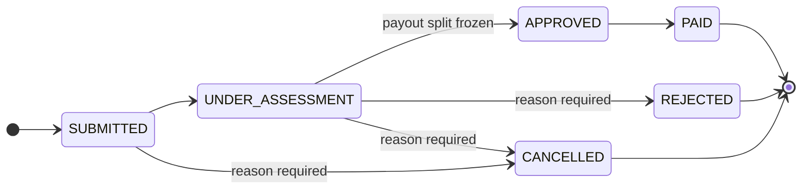
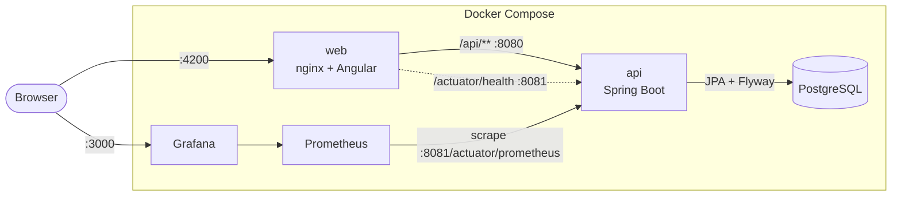

# Group Life Claims Platform

[](../../actions/workflows/ci.yml)

**Live demo:** _coming soon_ <!-- TODO(live-demo-url): after the first Azure deploy, replace
"_coming soon_" with [<LIVE_DEMO_URL>](<LIVE_DEMO_URL>) and sign in as member, assessor or admin
with password Password1! -->

Policy administration and claims for group life insurance: employer schemes, member cover,
beneficiaries, age-banded premiums and a claims workflow with a full audit trail.

It is a portfolio project. All names, numbers and amounts are synthetic.

<!-- TODO(demo-gif): record a 20-30 second walkthrough (member submits, assessor approves and pays,
     timeline and payout split), save it as docs/demo.gif and replace this comment with:
      -->

## What it does

- **Admins** set up employer schemes, policies (cover types, salary multiple, waiting period) and
  members.
- **Members** see their cover and premium, nominate beneficiaries and submit claims.
- **Assessors** work a queue of open claims, oldest first, and move each claim through its
  lifecycle. Every step records who, when and why.

Around that core:

| Feature | What it does |
| --- | --- |
| Live dashboard | Count-up KPIs, claims-by-status donut, six-month volume chart, decision-speed SLA meter, aging claims and recent activity; refreshes every minute |
| Claim conversation | Member ↔ assessor messages on each claim, plus internal notes members never see |
| Supporting documents | Drag-and-drop upload with progress; files are checked by their bytes (PDF, PNG, JPEG only), not their names |
| Assignment and SLA | Assessors pick up claims; queue filters for "mine" and "unassigned"; overdue claims pulse red |
| Notifications | In-app bell for new claims, decisions, messages and uploads, created in the same transaction as the change |
| Beneficiary editor | Live allocation ring that only unlocks saving at exactly 100% |
| Premium calculator | Sliders for salary, age and cover multiple over the real age-band rate table |
| Admin | Schemes, policies and members created through dialogs |
| Command palette | Ctrl+K to jump to any page, member or claim |
| Polish | Light, dark or system theme; animated page transitions; confetti when a claim is paid; all motion respects reduced-motion settings |



Business rules enforced by the API, each with its own error `code`:

| Rule | Code |
| --- | --- |
| The member was active on the event date | `MEMBER_NOT_ACTIVE` |
| The event is after the waiting period that starts at the join date | `WAITING_PERIOD` |
| The policy includes the cover type and was in force | `COVER_TYPE_NOT_COVERED`, `POLICY_NOT_IN_FORCE` |
| One open or paid claim per member per cover type | `DUPLICATE_CLAIM` |
| Beneficiary allocations total exactly 100% | `ALLOCATION_NOT_100`, `BENEFICIARIES_INCOMPLETE` |
| Rejecting or cancelling needs a reason | `REASON_REQUIRED` |
| Only allowed status changes | 409 `invalid-claim-transition` |

Payout = cover amount (annual salary × policy multiple), split by allocation and rounded so the
shares add up to the cent. Monthly premium = cover amount × the rate for the member's age band.

## Architecture



- **API:** a modular monolith packaged by domain (`scheme`, `policy`, `member`, `premium`,
  `claim`), with REST controllers, DTOs, Bean Validation and RFC 9457 problem details for every
  error. Schema changes are Flyway migrations; Hibernate only validates.
- **Security:** stateless JWT bearer tokens, role checks with `@PreAuthorize`, and ownership checks
  in the services. Members can only see their own records.
- **Web:** Angular with standalone components, signals and Angular Material, lazy-loaded per page.
  nginx serves it and proxies the API, so the browser never makes cross-origin calls.
- **Observability:** Micrometer exports claims by status, transitions and time to decision to
  Prometheus. Grafana is provisioned with a ready-made dashboard.

## Run it

Needs Docker. One command builds and starts everything with synthetic demo data:

```bash
docker compose up --build
```

| What | Where |
| --- | --- |
| Web app | http://localhost:4200 |
| API docs (Swagger UI) | http://localhost:8080/swagger-ui.html |
| Grafana dashboard | http://localhost:3000 (opens read-only; admin / `admin`) |
| Prometheus | http://localhost:9090 |

Demo accounts, all with password `Password1!`:

| User | Role | Try this |
| --- | --- | --- |
| `member` | Member | View your cover, message the assessor, upload a document, rebalance beneficiaries |
| `assessor` | Assessor | Dashboard, then the queue; try approving Sipho Dlamini's claim (blocked: no beneficiaries) |
| `assessor2` | Assessor | A second assessor, so assignment and notifications have someone to hand over to |
| `admin` | Admin | Create a scheme and policy, add members, press Ctrl+K and search |

To change ports or credentials, copy `infra/.env.example` to `infra/.env`. To start again from
fresh seed data, run `docker compose down --volumes`.

## Develop

```bash
docker compose up db                        # just the database
cd api && ./mvnw spring-boot:run -Dspring-boot.run.profiles=dev
cd web && npm ci && npm start               # http://localhost:4200, proxies /api to :8080
```

## Test

| Suite | Command | What it covers |
| --- | --- | --- |
| API unit and slice | `cd api && ./mvnw test` | State machine, eligibility rules, premiums, payout rounding, authorisation, error mapping |
| API integration | `cd api && ./mvnw verify` | The real API against PostgreSQL in Testcontainers (needs Docker) |
| Web unit | `cd web && npm test -- --watch=false` | Auth session and interceptor, error messages, shell, claim timeline |
| End-to-end | `docker compose up --build --wait` then `cd web && npm run e2e` | Cypress through the browser against the full stack |

CI runs all four on every push and pull request, then checks that Prometheus is scraping and
Grafana has loaded the dashboard.

## Deploy

The live demo runs on Azure Container Apps with a managed PostgreSQL database, declared in
[`infra/azure/main.bicep`](infra/azure/main.bicep) and deployed by a GitHub Actions workflow that
signs in to Azure with OpenID Connect. One-time setup is in
[docs/deploy-azure.md](docs/deploy-azure.md).

## Design decisions

Short records in [docs/decisions](docs/decisions/README.md):

1. [Modular monolith, packaged by domain](docs/decisions/0001-modular-monolith.md)
2. [Stay on Spring Boot 3.5 for now](docs/decisions/0002-spring-boot-3.md)
3. [Self-issued JWTs with Spring's resource server](docs/decisions/0003-self-issued-jwt.md)
4. [Claim state machine in the domain, with an append-only audit trail](docs/decisions/0004-claim-state-machine-and-audit.md)
5. [RFC 9457 problem details with stable codes](docs/decisions/0005-problem-details.md)
6. [Business metrics from the database, actuator on a private port](docs/decisions/0006-observability.md)
7. [Host the demo on Azure Container Apps](docs/decisions/0007-azure-container-apps.md)

## Repository layout

```
api/     Spring Boot service: one package per domain, Flyway migrations, tests
web/     Angular app, nginx config, Cypress end-to-end tests
infra/   Docker Compose, Prometheus config, Grafana provisioning and dashboard, Azure Bicep
docs/    Decision records and deployment guide
```
