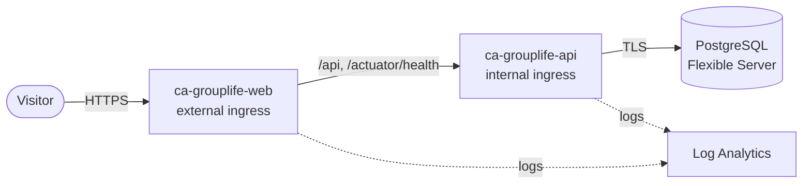

# Deploying to Azure

The live demo runs on Azure Container Apps with Azure Database for PostgreSQL Flexible Server.
[`infra/azure/main.bicep`](../infra/azure/main.bicep) describes it, and
[`.github/workflows/deploy.yml`](../.github/workflows/deploy.yml) builds the images, pushes them to
GitHub Container Registry and deploys.



## One-time setup

Replace every `<PLACEHOLDER>`.

1. **Resource group**

   ```bash
   az group create --name <RESOURCE_GROUP> --location <AZURE_REGION>   # for example southafricanorth
   ```

2. **Identity for GitHub Actions (OpenID Connect, no stored password)**

   ```bash
   az ad app create --display-name grouplife-deploy
   az ad sp create --id <APP_CLIENT_ID>
   az role assignment create --assignee <APP_CLIENT_ID> --role Contributor \
     --scope /subscriptions/<SUBSCRIPTION_ID>/resourceGroups/<RESOURCE_GROUP>
   az ad app federated-credential create --id <APP_CLIENT_ID> --parameters '{
     "name": "github-production",
     "issuer": "https://token.actions.githubusercontent.com",
     "subject": "repo:<GITHUB_OWNER>/<GITHUB_REPO>:environment:production",
     "audiences": ["api://AzureADTokenExchange"]
   }'
   ```

3. **GitHub settings** (Settings → Environments → `production`)

   | Kind | Name | Value |
   | --- | --- | --- |
   | Secret | `AZURE_CLIENT_ID` | `<APP_CLIENT_ID>` |
   | Secret | `AZURE_TENANT_ID` | `<TENANT_ID>` |
   | Secret | `AZURE_SUBSCRIPTION_ID` | `<SUBSCRIPTION_ID>` |
   | Secret | `POSTGRES_ADMIN_PASSWORD` | A strong generated password |
   | Secret | `JWT_SECRET` | `openssl rand -base64 48` |
   | Secret | `GHCR_READ_TOKEN` | A classic personal access token with `read:packages`, so Azure can pull the images |
   | Variable | `AZURE_RESOURCE_GROUP` | `<RESOURCE_GROUP>` |

4. **Deploy:** Actions → *Deploy to Azure* → *Run workflow*. The job summary prints the live URL.
   Put it at the top of the README in place of the live demo placeholder.

## Notes

- The `demo` Spring profile seeds the same synthetic data as local development. Demo accounts and
  the shared password are public by design; nothing else is stored.
- Cost is roughly the Burstable B1ms database plus one always-on API replica. The web app scales to
  zero when idle. Delete the resource group to remove everything.
- Hardening for real use: VNet integration with a private endpoint for PostgreSQL instead of the
  "allow Azure services" firewall rule, Key Vault references for secrets, an identity provider
  instead of self-issued tokens (see [ADR 3](decisions/0003-self-issued-jwt.md)), and Azure Monitor
  managed Prometheus for metrics.
